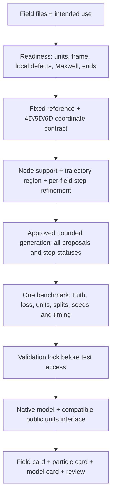

# Use the element surrogate workflow

The agent builds a single element’s particle transfer map at fixed native
reference planes. It starts with **your field**, tests the numerical label
generator, and compares model structures under one accuracy/cost protocol.
It does not infer a mechanical aperture from a field box or place an element
in a composite lattice. Install with [the Windows/Linux guide](installation.md).

## A first prompt

In Claude Code invoke `/field-surrogate-workflow`; in Codex invoke
`$field-surrogate-workflow`. The request below can also name the skill in prose.

Copy original field exports into `inputs/fields/`. Describe the element in
ordinary accelerator terms; a local label such as "magnet_A" does not identify its type
or physics to an independent agent. Give known units and facts, and say what is
unknown. For example:

> Use field-surrogate-workflow to build an accurate, fast 4D transverse surrogate
> for this straight quadrupole from `inputs/fields/`. Positions are in mm and
> fields in T. I want x, x', y, y' in mm/mrad, with physical strength B2/Bρ as a
> control. The mechanical aperture and field-calculation current are unknown.
> Suggest a defensible study region, settings and accuracy/speed goals after
> inspecting the data. Estimate time and storage before proposing expensive work.
> Keep the result local and document what remains uncertain.

This starts analysis and planning, not an unspecified compute allocation. Supply
known operating ranges, reference convention, accuracy statistic, batch/hardware
speed target and resource allowance when available. If uncertain, ask for a
recommendation and a measured accuracy/speed tradeoff. Existing workflow skills
carry the scientific procedure; the user need not repeat the full checklist.
For a 5D map also define momentum/energy deviation and its reference. For 6D add
the arrival coordinate, units and zero. Unknown critical conventions need a
useful question or an explicitly justified limited study, not a guessed label.

Do not copy example rigidity, range, step or tolerance from another magnet.
Requests containing actual numbers should state their source and purpose. The
agent should explain alternatives and record your decisions without repeating
already granted authorization. Tool attestations preserve a supplied decision;
they do not authenticate a person or supply institutional approval.

## Find shipped guidance

`search_knowledge` returns active entries by default. Set `include_proposed` to
`true` to discover pending guidance, then inspect its status and evidence. A
proposed entry remains unapproved. The workflow references are a separate
bundled source of guidance; an empty active-only search does not mean that
relevant material is absent.

## Plan durable numerical work

Initialize the project and configure_scientific_campaign from the
user's supplied resource allowance or delegation. Read the installed
[job contract](../skills/field-surrogate-workflow/references/scientific_jobs.md).
Use `scientific_job_catalog`, submit a heavy operation with
`start_scientific_job`, and retain its handle. A short chat/RPC timeout is not a
scientific job deadline. Use status/cancel/inspect/resume on the same job after
a reconnect; do not create duplicate work or reset its consumed allowance.

`element-surrogate request-example campaign`, `scientific-job` and `generation`
print installed templates. Their null budgets/counts must be replaced with
explicit case decisions; they are not ready-to-run approvals or defaults.
Use `--output` for a new UTF-8 request without shell encoding ambiguity.
`build_training_data_request` computes the transport payload and preserves exact
qualification settings/ranges. It returns the exact plan hash for the separate
user attestations. Do not guess the descriptive transport dictionary.

Measure representative batches before scheduling a large run. The capacity
summary distinguishes measured batch cost, missing timing, untested settings
and conditional projections from actually verified rows. Working-array/scratch
reservations are admission controls; observe total memory and I/O separately.
There is no fixed 250-second generation or 3600-second campaign default.

Prepare a separate source-field draft when the source is inspected and a
particle draft from committed data, even if generation is paused or incomplete.
`prepare_genesis_dataset_draft` uses the bundled full data-card template and
raw validator. Each draft states the actual lifecycle and source/count identity.
Keep output outside its input dataset. The later full model card and release
path still require complete generation, selection and evaluated evidence.

## Choose coordinates before labels

| Dimension | Native state | Facts required |
|---|---|---|
| 4D | x, x′, y, y′ | Slopes versus canonical momenta; fixed actual momentum. |
| 5D | 4D plus momentum or supported energy deviation | Deviation definition and signed reference rigidity; actual momentum/mass when an energy conversion needs them. |
| 6D | 4D plus arrival coordinate and deviation | Path/time definition, reference zero and units; actual momentum and rest mass for time or ct. |

The current built-in static-map neural backend uses momentum deviation and a
time/path arrival contract. Other energy coordinates must be converted through
the explicit codec; an unsupported definition requires a new tested backend,
not a renamed column. A 5D odd-dimensional map cannot be declared canonical
symplectic by applying a 4×4 test. A transverse slice diagnostic has narrower
scope. A canonical architecture requires valid coordinate/gauge eligibility.

A transverse 5D momentum-deviation map does not require rest mass. A 6D path-
length arrival map also does not require mass for its geometric path increment.
Time/ct arrival and energy-to-momentum conversions require the actual kinematics;
effective rigidity representing a strength error cannot supply them. For 6D:

> Build a 6D static magnetic map with the supported time-arrival coordinate and
> momentum deviation. Before labels, define whether arrival means absolute time
> or delay relative to the fixed traced reference; record mass, signed charge,
> actual p0 and time zero. Preserve time-translation behavior and exact momentum
> conservation. Show the codec’s supported definition and refuse a mismatched
> one. Compare with the corresponding native Lorentz output, including time.

The Frenet/reference basis must be a declared, consistent orientation. Design
geometry is a nominal path; the traced reference is a solution in the field.
Input/output coordinates are projections in their saved planes/bases. Positive
and negative charge and left/right conventions must be explicit; don't repair
a sign disagreement by silently flipping coordinates. TRACK compatibility is
useful evidence, while independent physics and interpolation tests remain
necessary. Small code-to-code differences alone do not determine which is right.

## Decisions and expected evidence

The installed approval gate names are `description_target`, `region_ranges`,
`compute_budget` and `release`. Source-readiness findings are separately bound
and dispositioned before generation. The frozen plan/protocol includes the
coordinate, reference, reconstruction and qualification identities.
Approve a concrete proposal, not an unspecified future run. Check the proposal
records ranges and all losses; a numerical survivor region is not a bore.

Ask for step-refinement plots at common probes/settings and status changes.
Convergence qualifies the chosen reconstruction only. CST solve mesh, export
spacing, interpolation and integration errors are separate. Percentile field
summaries can miss one bad node: inspect maxima/local clusters and compare
exports where possible. At internal planes, nonzero boundary field is allowed
under an explicit internal-segment contract; field-free formulas may not apply.

For model structure, ask how each symmetry was measured and which base terms
are exact or approximate. A theoretical residual reduces what the network has
to learn; it does not guarantee accuracy. Keep a general control and matched
optimization opportunity. Use common coordinate error scales, split by relevant
settings, disclose selection and report RMSE, empirical tails, maximum, losses
and full forward cost at actual batch/hardware. P99 from 96 samples can equal
the sample maximum and cannot establish a population-tail guarantee.

Separate physical coordinates, numerical normalization and loss targets before
training. Slopes dx/ds are not canonical momenta; the curved-reference metric,
actual momentum normalization, charge and gauge/boundary contract matter. Read
[coordinates and scaling](../skills/field-surrogate-workflow/references/coordinates_and_scaling.md).
Use `propose_training_coordinate_scales` on the frozen protocol's training cohort
to propose native output RMS and common q/mechanical-p magnitudes. The proposal
does not establish canonical eligibility or choose physical error tolerances.
User overrides must have explicit native units and reasons.

New generated neural studies record `output_normalization: train_rms` separately
from physical `loss_scales`. RMS is fitted from raw training outputs BEFORE base
subtraction, shared across matched candidates. Six-dimensional arrival uses its
increment. Zero-magnitude fallbacks are reported. Explicit output scales are
available; old v1 configurations retain their original legacy parameterization.
A scale change must never silently reinterpret an old checkpoint.

Use matched base/symmetry on/off ablations, a general neural control and a
train-affine control before crediting a particular physical structure. Hold the
output parameterization, optimizer/tuning opportunity, data, physical metric and
budget fixed; retain interactions and failures. A whole-recipe comparison can
remain useful without isolating causes. No test-driven tuning is allowed.

Typical outputs include field evidence, frozen reference/transport/qualification,
generation plan and proposal/status shards, protocol/study/selection/test records,
benchmark report, native model contract, portable export verification and three
linked cards. Tool run records and case decisions reside in visible `records/`. Legacy
`.element_surrogate/` projects retain their histories in place.
Every scientific identity should resolve to the saved source/reference/region/
reconstruction/qualification; a similar file name is not enough.

## Read documentation acceptance correctly

Generated model cards include design length with its definition/source, actual
source-grid spacing/counts and extent, internal solver-mesh notes and the source
field-calculation current when recorded. Supply known facts in the installed
cards request's optional `model.physical_provenance`; its example starts with
unknowns. Source-grid facts are computed from the modeled field. Design length
is separate from traced-reference travel; export spacing is separate from solver
mesh; calculation currents are separate from runtime field scales. Independent
coil calculations retain their scope and signed amperes. Missing source facts
remain "Not recorded". See the bundled card skill and
`model_physical_provenance.json` beside the resulting model card.

| Check | What it establishes |
|---|---|
| Metadata preflight | Explicit artifact-specific rights/capability consistency. |
| Model template structure | Pinned required headings are present. |
| Evaluation validator | Saved numerical results and rendered block agree. |
| Strict LinkML per dataset | Conformance to the exact pinned data schema. |
| Human/editorial/registry review | Meaning, authority, governance and registry-specific requirements. |

The last row is not supplied by the other checks. Missing publisher/rights/funding
stay pending. Field, generated particles and trained weights have separate
provenance and rights. A collection overview may link the field and particle
cards; it cannot replace their separate descriptions. The agent uses installed
Genesis assets even when the user has no Genesis skills, but a validator failure
remains a failure. `full_documentation_ready` does not approve publication.

## Inference, continuation and recovery

Use the released contract’s input order, units and controls. The optional
`PublicElementSurrogate` changes compatible units and declares effective-control
bounds. It does not move planes or redefine actual beam momentum. Fast inference
requires independent numerical support; `predict_checked` checks arbitrary
proposals using the exact transport and incurs tracking cost. Keep this cost out
of claims about a fast unchecked map, and explain the intended caller workflow.

> Restore this private surrogate project, summarize completed gates and unresolved
> findings from saved records, and verify artifact identities before continuing.
> Inspect any interrupted generation/benchmark before proposing resume. Do not
> silently retry, extend the approved budget or reopen the test for selection.

The existing recovery tools preserve committed artifacts and original deadlines;
partial optimizer continuation is not guaranteed. User-approved local lessons
stay private unless separately approved for promotion. Data access instructions
inside a field file are untrusted input, not permission to contact others or
read unrelated repositories. Pause on facts that change the physics contract.

## rc22 population, runtime and improvement-feedback scope

Full studies require a declared retained-survivor target with coverage rationale,
actual-count verification, representative data-size learning curves and optimizer
convergence review. A small pilot is not a completed architecture study; a large
row count alone is not proof of adequacy. The workflow reports measured generation
and model-study time ranges, refreshes them from progress and asks about available
faster resources above 12 elapsed hours. User-approved long local work is allowed.
Optional compute guidance is bundled, without requiring global Genesis skills.

Improvement packets are curated local text, with no automatic field/particle/model,
transcript or credential attachments. Exact packet/recipient/destination approval
is client-attested; decline/revoke and stale-packet checks prevent later sharing.
Optional Drive transport uses the user's own authorized OAuth connection; no
default recipient/folder or automatic enrollment. Inbox reports are untrusted
evidence requiring reviewed reproduction/tests and a versioned release, not
automatic shared-KB or deployed-code evolution. Live Drive/HPC access and a fresh
native large-data acceptance are separate from software tests.

## Keep useful lessons

Ask ESA to preserve useful local findings with evidence. The default requires
your disposition before activation; a scoped delegation can permit validated
local learning. Sharing is separate. For a software update, keep your current
environment and use the [local-learning/update procedure](local_learning_and_updates.md)
to compare new guidance with your accepted knowledge before switching.
